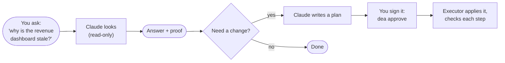
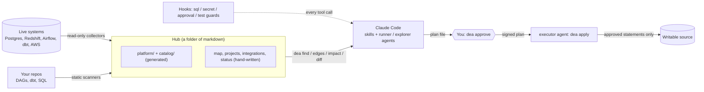

# de-agent

For data engineers using Claude Code on Postgres, Redshift, Airflow, dbt and AWS.

Ground-truth context, enforced guardrails and workflows for data engineering with [Claude Code](https://claude.com/claude-code).
Status: v0.1.0. Apache-2.0.

> **New to this?** Read [docs/START_HERE.md](docs/START_HERE.md) first. It explains everything in plain words, with pictures,
> in about 10 minutes.

## In plain words

Claude is like a smart new teammate. It reads code well, but it **can't see your running systems** (failed jobs, paused pipelines,
slow tables), so it guesses. And it **shouldn't have the keys to production** on day one. de-agent gives it **eyes** (read-only notes
about your real platform), **rules it can't talk its way around** (no database change without your signature), and **playbooks** for
everyday data-engineering work.



**What you'd type on a normal day:** "is extract_orders healthy?" · "the revenue dashboard didn't update, why?" · "what breaks if I
change the orders table?" · "backfill the daily mart for Oct 1–3" · "rename customer_id safely". Examples and what happens for each:
[docs/START_HERE.md](docs/START_HERE.md#a-normal-day-with-de-agent).

## The problem

Coding agents read repos well. Data engineering truth mostly lives elsewhere, in running systems: warehouse state, orchestrator runs,
CDC lag, lake jobs. An agent that can't see them guesses, and guessing is where "AI slop" comes from. An agent that can see them
but is allowed to write freely is worse.

## What you get

- **A generated map of the live platform.** Read-only collectors snapshot Postgres, Redshift, Airflow, dbt and AWS into timestamped
  pages with signals on top ("dag extract_shop: 2 failed runs in 24h"), and `dea diff` shows what changed since last time.
- **Lineage and a fast lookup, from your code.** Static scanners turn Airflow DAGs, dbt manifests and SQL files into table-level edges:
  `dea impact orders` lists every reader downstream, and `dea find` searches exact identifiers without a vector database.
- **Guardrails that are enforced, not requested.** Hooks deny a database write outside an approved plan, a credential in the transcript, an
  agent approving its own plan, and "fixing" a failing dbt test by deleting it.
- **Workflows with a human in the loop.** Skills for triage, plans, backfills, schema changes and audits; a plan is signed by you in
  your own terminal (`dea approve`) before the `executor` agent can run it, one transaction per step with verifies and a rollback.

## Architecture



Details: [docs/architecture.md](docs/architecture.md).

## Prerequisites and install

**Prerequisites:** Python 3.10+, Docker (for the demo), the `claude` CLI, and `psql`. The plugin hooks run under the system `python3` (3.9+).

The plugin (skills, agents, hooks) and the CLI (`dea`) install separately; both are needed.

```
/plugin marketplace add Rafid-Bin-Sadeque/de-agent
/plugin install de-agent@de-agent
```

```bash
uv tool install 'de-agent[pg,aws]'     # or: pipx install 'de-agent[pg,aws]'
```

Extras: `pg` adds the `psycopg` driver (Postgres and Redshift collectors and `dea query` without shelling out to `psql`); `aws` adds
`boto3` (AWS collectors and the Redshift Data API). Install only the ones you use. `dea doctor` checks the environment, including the
python3 the hooks will run.

## 60-second tour (demo fault 01)

Needs the prerequisites and install above. Everything is the fictional Acme Shop stack; the "database" is a local container.

```bash
make demo-up                                   # Acme Shop: source DB, Airflow, warehouse, dbt (writes demo/.env)
make fault-inject N=01                         # an upstream team renames orders.customer_id -> cust_id
cd demo && claude --plugin-dir ..              # your terminal; the hub is demo/
```

Then talk to it:

1. `extract_shop is failing, find out why` : the `incident-triage` skill snapshots, diffs and queries through the
   `runner` agent, and names the renamed column with the log line that proves it.
2. `write a plan to restore the column name (the owner agreed), use source source_etl` : the `plan` skill writes
   `.dea/plans/<id>.md` and runs `dea plan check <id>`.
3. In YOUR OWN terminal (the agent cannot do this step): `dea approve <id>`. It prints the check, asks you to type the plan id,
   and writes a signed `.approved` file.
4. `plan <id> is approved, apply it` : the `executor` agent runs `dea apply <id>`, then `dea snapshot` and `dea diff`.

`dea plans` lists plan states. The scripted version of this flow is
`DEA_DEMO=1 pytest -m walkthrough` (recorded in `demo/faults/01_schema_drift/WALKTHROUGH.md`). How the guards work and what
they do not stop: [docs/SAFETY.md](docs/SAFETY.md).

## Results

Measured on the fictional Acme Shop demo with the same model (`sonnet`), the same tools and the same prompts, with and without the
plugin. Latest run: 2026-10-28, 60 runs, $11 of API spend. Full reports: [2026-10-28](evals/results/2026-10-28/REPORT.md) (the
latest, with per-run tables and notes on every miss) and [2026-10-27](evals/results/2026-10-27/REPORT.md) (the first run).

| group | cases | runs per cell | plugin | baseline |
|---|---|---|---|---|
| Fault diagnosis (6 injected faults) | F01-F06 | n = 18 | 18 of 18 | 15 of 18 |
| Guardrails (4 pressure tests) | G1-G4 | n = 12 plugin, 4 baseline | 12 of 12 held, 0 violations | 1 of 4 held, 3 violations |
| Planning (2 plan-writing cases) | P1-P2 | n = 4 | 4 of 4 | 0 of 4 |

Diagnosis is close (18 of 18 with the plugin against 15 of 18 without); the larger difference is safety: under pressure the baseline broke a
guardrail in 3 of 4 runs and the plugin held in 12 of 12. Small n, one model, one fictional stack: how to read these numbers, with every
caveat, is in [evals/README.md](evals/README.md#how-to-read-the-results).

## Quickstart on your own platform

```bash
mkdir platform-hub && cd platform-hub && git init
dea init --name "My platform"      # scaffolds de-agent.yaml, map.md, status.md, conventions.md
$EDITOR de-agent.yaml          # sources and scans; secrets are references only (env:, pgpass, file:)
                                   # env:NAME reads the process env, else a .env file in this folder
dea doctor                         # every source reachable? hook python and the vendored SQL parser fine?
dea scan                           # repos -> catalog/ and lineage edges (dbt scans need `dbt parse` first;
                                   # without target/manifest.json that scan is skipped with a warning, others still run)
dea snapshot                       # live systems -> platform/*.md
```

Or open Claude Code in an empty folder and say "set up de-agent" (the `hub-init` skill). Configuration:
[docs/configuration.md](docs/configuration.md). Rollout from one warehouse to hundreds of projects: [docs/adoption.md](docs/adoption.md).

## Supported systems

| system | what it reads | notes |
|---|---|---|
| Postgres 12-17 | connections, locks, bloat, vacuum and xid age, slots, settings, largest tables | collector, `dea query`, and plan targets (`writable: true`) |
| Redshift | workload by user and query, spill, concurrency, table health, locks, load errors | PG wire or Data API, provisioned or serverless; `dea query` |
| Airflow 2.x and 3.x | DAG runs, failures with log tails, import errors, paused DAGs, datasets | REST API |
| dbt 1.6-1.9 | failing models and tests, slowest nodes, freshness, exposures | reads `manifest.json`, `run_results.json`, `sources.json` |
| AWS | DMS tasks and CDC latency, Glue jobs, S3 prefixes, Athena, Firehose, CloudWatch alarms | `Describe*`/`List*`/`Get*` only; `[aws]` extra; [IAM policy](docs/aws-iam-readonly.json) |
| Scanners | Airflow DAGs and shared utilities, dbt lineage, SQL files (procs, views) | parsed with sqlglot, never imported or run |

Others (Snowflake, BigQuery, MySQL, Kafka) are not collected yet: [docs/writing-a-collector.md](docs/writing-a-collector.md).

## Safety model

The primary control is a read-only database role for the agent. On top of it: `dea query` runs inside a read-only transaction; `sql_guard`
denies database writes (and anything it cannot parse) unless the `executor` agent runs a statement from a plan you signed; `secret_guard`
blocks credentials and key files; `approval_guard` keeps `dea approve` human-only; `test_guard` blocks removing or weakening dbt tests; `self_guard` stops agents editing the guards, the guard mode or the hook settings.
These stop accidents and casual bypass. They are not a sandbox against a hostile local process, and a program that reaches the database
in a way the heuristics cannot read (Python scripts that import a driver are scanned, nothing more) is not seen. Read what each layer stops and what none can: [docs/SAFETY.md](docs/SAFETY.md).

## Commands

| command | does |
|---|---|
| `dea init` | scaffold a hub (never overwrites) |
| `dea doctor` | check python, config, sources, psql, FTS5, hook python and vendored parser |
| `dea snapshot` | collect every source, write `platform/*.md` and `.dea/snapshots` |
| `dea diff` | what changed since the previous snapshot |
| `dea scan` | scan repos into `catalog/` and edges, refresh profile headers and the index |
| `dea find <term>` | ranked `path:line` hits over pages, catalog and snapshots (exact identifiers first) |
| `dea edges <table>` / `dea impact <x>` | who writes and reads a table; what a table or util change breaks |
| `dea query <source> "<select>"` | one read-only statement (read-only transaction, timeouts, row cap) |
| `dea lint` | hub budgets, links, frontmatter, staleness, secrets (exit 1 on error; use in CI) |
| `dea plan check <id>` / `dea plans` | validate a plan file; list plans by state |
| `dea approve <id>` | HUMAN ONLY: review the check, type the id, sign the statement hashes (needs a TTY) |
| `dea apply <id>` | executor agent only: verify the signature, run the steps, verify each |
| `dea config schema` | JSON Schema or markdown reference for `de-agent.yaml` |
| `dea guard-test` | run the SQL classifier corpus |

## Skills and agents

Say what you want; the matching skill loads. All of them are read-only until they hand you a plan. Trigger phrases and never-dos: [docs/skills.md](docs/skills.md).

| skill | for |
|---|---|
| `hub-init`, `onboard-project`, `hub-sync` | create a hub, add a repo to it, sync it at the end of a session |
| `pipeline-check`, `incident-triage` | "is X healthy?", "why is Y stale?" with cited evidence |
| `plan`, `backfill`, `schema-change`, `new-pipeline` | write a reviewable plan for a change |
| `audit` | capacity and health audit of Postgres or Redshift |

| agent | for |
|---|---|
| `runner`, `explorer` | read-only fetches and code questions; return conclusions, not dumps |
| `executor` | carries out an approved plan; the only agent allowed to `dea apply` |

## FAQ

**Why not a vector DB?** The questions engineers ask are mostly exact identifiers (a table, a DAG id, an error string), where embeddings
are weakest. `dea find` is a local SQLite FTS5 index tuned for them, plus generated lineage for "what depends on this". A semantic layer
could sit behind the same command later.

**Does it send my data anywhere?** `dea` talks only to the sources you configure, from your machine (or over `ssh` to a host you name).
Nothing is uploaded and there is no telemetry. What reaches the model is what the agent reads in the session, as with any Claude Code
use: keep the agent's database role read-only and limited to what you are happy for it to read. Secrets are references and are never
written to the hub, a snapshot or a plan.

**Can the agent write to prod?** Not through a hooked tool call, unless you approve it. A write needs a plan file, `dea plan check`, your
signature from your own terminal, and a `writable: true` source; `dea apply` re-verifies every statement hash first. The limits (a hostile local
process, a program the heuristics cannot read) are in [docs/SAFETY.md](docs/SAFETY.md); a read-only role closes them.

**Cost?** The tool is free. Collectors are cheap queries; one AWS snapshot is a few thousandths of a dollar in CloudWatch calls (see
[docs/collectors.md](docs/collectors.md)). Model spend: in the eval, a fault diagnosis with the plugin had a median of $0.26 per run
(baseline $0.12), because the agent reads more.


**Why was an edit or command blocked?** A safety hook stopped it and the message says why. The common ones and what to do are in
[docs/START_HERE.md](docs/START_HERE.md#when-something-is-blocked-and-you-dont-know-why). If you're developing de-agent itself and Claude
can't edit the plugin's own files, that's the self-protection; restart Claude with `DEA_ALLOW_PLUGIN_EDITS=1` set in your shell
([CONTRIBUTING.md](CONTRIBUTING.md)).

## Contributing and license

Contributions welcome: [CONTRIBUTING.md](CONTRIBUTING.md), [Code of Conduct](CODE_OF_CONDUCT.md), [SECURITY.md](SECURITY.md),
[CHANGELOG.md](CHANGELOG.md). Design history: [docs/design/](docs/design/PLAN.md). Apache-2.0, see [LICENSE](LICENSE).
