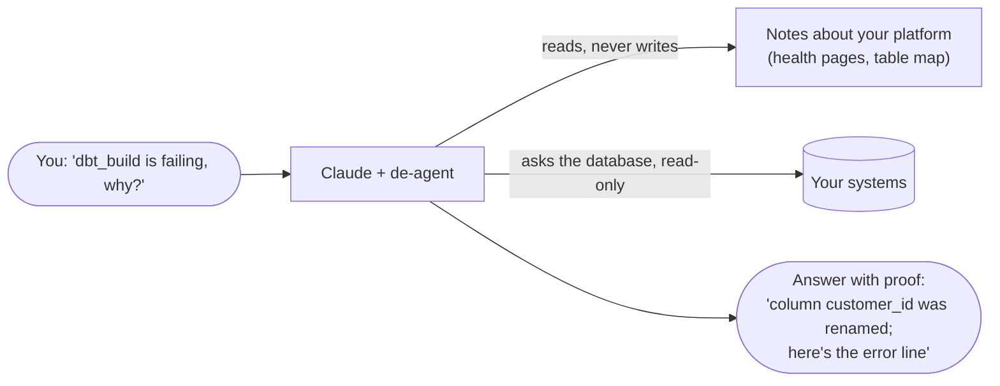
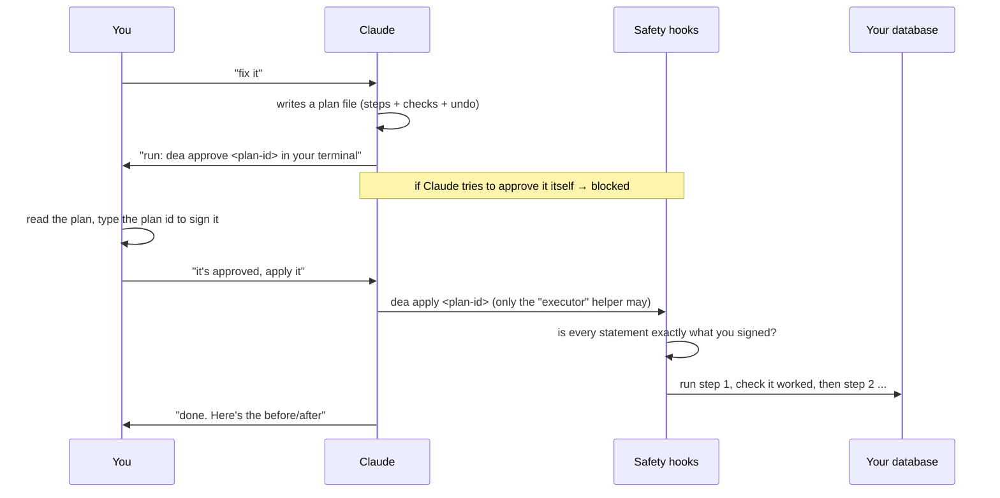

# Start here: de-agent in plain words

This page assumes nothing. If you know a little SQL and have heard of Airflow, that's enough.

## The one-minute version

Think of an AI assistant (Claude) as a smart new teammate on your data team.

- **It can read code very well.** But most of what matters in data engineering isn't in the code. It's in the **running systems**: is
  the pipeline paused? Did last night's job fail? Is a table full of dead rows? A new teammate who can't see any of that **guesses**.
- **A new teammate shouldn't have the keys to production on day one.** You wouldn't let them run `DELETE` on the warehouse, kill other
  people's queries, or read the database password, just because they asked politely.

**de-agent fixes both:**

1. It gives Claude **eyes**: a set of read-only notes about your real systems and code, refreshed whenever you ask.
2. It gives Claude **rules that can't be talked around**: it physically blocks risky actions unless a human signs off.
3. It gives Claude **good habits**: step-by-step playbooks for common data-engineering jobs (debugging a failure, backfilling, changing a column).



## The three parts

| Part | Plain words | You'll see it as |
|---|---|---|
| **The `dea` tool** | A small command-line program that collects facts. It reads your repos and your systems (read-only) and writes what it finds into a folder of simple text files. | `dea scan`, `dea snapshot`, `dea find` |
| **The hub** | That folder of text files: a map of your platform. Some pages are written by `dea` (always fresh), some by you (things only a human knows, like "this job must run before that one"). | a folder with `map.md`, `platform/`, `catalog/` |
| **The Claude plugin** | Teaches Claude to use the hub, gives it playbooks ("skills") and helpers ("agents"), and installs the safety rules ("hooks"). | you just talk to Claude normally |

## A normal day with de-agent

You open Claude in your hub folder and type like you'd message a colleague. Some examples:

| You type | What happens |
|---|---|
| "**Is extract_orders healthy?**" | Claude checks the latest runs, failures and freshness for that pipeline and answers *healthy / degraded / broken*, quoting the evidence. |
| "**The revenue dashboard didn't update today. Why?**" | Claude takes a fresh snapshot, compares it with the last one, follows the data upstream (dashboard ← mart ← model ← raw table ← pipeline) and finds the first broken link. Example: "the extract pipeline is paused". |
| "**What breaks if I change the orders table?**" | Claude runs `dea impact orders` and lists every model, job and export downstream, with the path to each. |
| "**Backfill the daily revenue mart for Oct 1–3.**" | Claude writes a **plan**: what to run, in what order, how to check each step worked, and how to undo it. It doesn't run anything yet. |
| "**Rename customer_id to cust_id safely.**" | Claude writes a plan using the safe pattern (add the new column, copy data, switch readers, remove the old column later), instead of a risky one-shot rename. |

Anything that **changes** something always goes through a plan that **you** approve. More on that below.

## How a change gets made safely

This is the most important flow. Claude can investigate freely, but it can never change your systems on its own.



Why this matters: the signature is cryptographic. If even one character of the plan changes after you sign, it won't run.

## What the safety rules block (for everyone, including Claude)

| Blocked | Why |
|---|---|
| Writing to a database (`DELETE`, `UPDATE`, `DROP`, …) without a signed plan | stops accidental damage to real data |
| Reading or printing passwords, keys and `.env` files | keeps secrets out of the chat |
| Claude approving its own plan | a human must always sign off |
| "Fixing" a failing test by deleting or weakening it | hiding a problem isn't fixing it |
| Editing the safety rules themselves | so they can't be switched off quietly |

When Claude hits one of these, it gets a short message explaining why, and usually tells you what to do instead. These rules are real code
running before every action, not instructions Claude could choose to ignore. Full details and limits: [SAFETY.md](SAFETY.md).

## Words you'll see

| Word | Meaning |
|---|---|
| **hub** | the folder of notes about your platform |
| **collector** | the part of `dea` that reads one kind of live system (Postgres, Airflow, AWS…), read-only |
| **snapshot** | one reading of all your systems at a moment in time (`dea snapshot`) |
| **signal** | a warning found in a snapshot, e.g. "2 failed runs in 24 h" or "40% dead rows" |
| **diff** | what changed between two snapshots (`dea diff`) |
| **scanner** | the part of `dea` that reads your code (DAGs, dbt, SQL) without running it |
| **catalog / edges / lineage** | the generated map of which job writes which table and who reads it |
| **skill** | a playbook Claude follows for a task, e.g. *incident-triage*, *backfill* |
| **agent** | a helper Claude can hand work to: *runner* (looks things up), *explorer* (reads code), *executor* (applies approved plans) |
| **hook** | a safety check that runs before every action Claude takes |
| **plan** | a file listing exactly what will change, how to check it, and how to undo it |
| **approve / apply** | you sign the plan (`dea approve`), then the executor runs it (`dea apply`) |

## Try it in 10 minutes (no real systems needed)

The repo includes a pretend online shop ("Acme Shop") that runs on your laptop in Docker, with problems you can switch on.

```bash
# 1. install (once)
uv tool install 'de-agent[pg,aws]'      # the dea tool
# in Claude Code:  /plugin marketplace add Rafid-Bin-Sadeque/de-agent   then   /plugin install de-agent@de-agent

# 2. start the pretend shop and break something
make demo-up
make fault-inject N=01                    # someone renamed a column the pipeline needs

# 3. ask Claude
cd demo && claude --plugin-dir ..
#   > extract_shop is failing, find out why
```

There are six faults to try (`N=01` … `06`): a renamed column, a paused pipeline, a bloated table, a missing index, a failing data test,
and a query stuck behind a lock. Each one's expected answer is in `demo/faults/NN_*/EXPECTED.md`, so you can check Claude's work.

## Using it on your real platform

1. `dea init` in a new folder. That folder is your hub.
2. Edit `de-agent.yaml` to list your repos and databases. **Never put a password in it.** Point to `~/.pgpass` or an environment variable instead.
3. `dea doctor` (checks everything is reachable), then `dea scan` (reads your code), then `dea snapshot` (reads your systems).
4. Open Claude in that folder and start asking.

Step-by-step with examples: [adoption.md](adoption.md). Every config option: [configuration.md](configuration.md).

**Good practice:** give the database user de-agent uses **read-only** permissions. The safety rules are strong, but a read-only user
makes accidents impossible at the database level too.

## When something is blocked and you don't know why

| Message starts with | What it means | What to do |
|---|---|---|
| `de-agent: … is a write; writes need an approved plan` | Claude tried to change the database directly | ask Claude to write a plan instead |
| `de-agent: approving a plan is a human-only action` | Claude tried to approve its own plan | run `dea approve <id>` yourself, in your own terminal |
| `` de-agent: `dea apply` runs only from the executor agent `` | the main session tried to apply a plan itself | say "apply plan <id> with the executor"; only that helper may run approved plans |
| `de-agent: input too large to check` | a command was too big for the safety check to read in time | ask Claude to split it into smaller steps |
| `de-agent: … secrets must not enter the transcript` | something would have shown a password | nothing to do; it's working as intended |
| `de-agent: removing or weakening a dbt test …` | Claude tried to delete or soften a failing test | fix the cause, or if the test itself is wrong, change it through a plan |
| `de-agent: the guards protect themselves` | something tried to edit de-agent's own files | normal users: nothing to do. **Developing de-agent itself?** Restart Claude with `DEA_ALLOW_PLUGIN_EDITS=1` set in your shell ([CONTRIBUTING.md](../CONTRIBUTING.md)) |
| `de-agent: SQL passed via a shell variable can't be checked` | the SQL was hidden in a variable like `$Q` | ask Claude to put the SQL directly in the command |

Still stuck? Run `dea doctor`. It checks your setup and tells you the first thing to fix.
