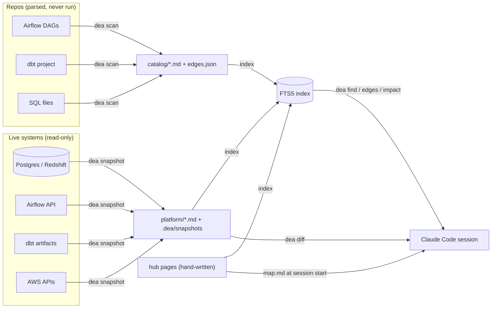
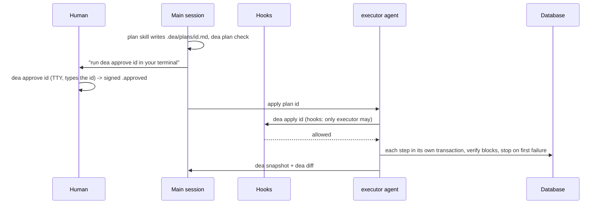

# Architecture

de-agent is a Claude Code plugin plus a small Python CLI (`dea`). The plugin carries the skills, agents and hooks; the CLI
carries everything that has to be deterministic: collecting, scanning, indexing, classifying SQL, signing approvals and applying plans.
The design rationale is in [design/KNOWLEDGE_ARCHITECTURE.md](design/KNOWLEDGE_ARCHITECTURE.md); this page is the user-facing map.

## Layers

| layer | what it does | lives in |
|---|---|---|
| Collectors | Read live systems (Postgres, Redshift, Airflow, dbt artifacts, AWS) with read-only calls and write one JSON result per source | `cli/src/de_agent/collectors/` |
| `platform/` | Markdown rendered from the collector JSON: deterministic, timestamped, signals up top. Generated, never hand-edited | hub, written by `dea snapshot` |
| Scanners | Parse repos statically (Airflow DAGs, dbt manifests, SQL files). Scanned code is never imported or run | `cli/src/de_agent/scanners/` |
| `catalog/` | Markdown and JSON from the scanners: DAGs, models, objects and the table-level lineage edges. Generated | hub, written by `dea scan` |
| Hub pages | The small hand-written part: `map.md`, domain and project pages, `integrations/`, `conventions.md`, `status.md` | hub, written by people |
| FTS index | SQLite FTS5 over hub pages, catalog and snapshots; `dea find` answers exact identifiers first | `.dea/` (local, ignored) |
| Hooks | Deterministic guards on every tool call: SQL writes, secrets, approvals, dbt test edits; a session-start context injector; a stop check | `hooks/hooks.json`, `scripts/` |
| Agents | `runner` (read-only lookups), `explorer` (code and hub questions), `executor` (carries out an approved plan) | `agents/` |
| Skills | The workflows: triage, plan, backfill, schema change, audit and so on; see [skills.md](skills.md) | `skills/` |

The main session thinks and decides; `runner` and `explorer` fetch facts and return conclusions (so bulky output never lands in the
main context); `executor` is the only agent allowed to run `dea apply`, and only for a plan a human approved.

## Data flow



## The change path



A write that is not in the signed plan never reaches the database through a hooked tool call: `sql_guard` denies it. Details and the limits of
this guarantee are in [SAFETY.md](SAFETY.md).

## Anatomy of a hub

A hub is a plain folder, ideally a git repo of its own. `dea init` scaffolds it.

```
my-hub/
  de-agent.yaml        sources, scans, guard mode (secret references only)   [you edit]
  map.md                  always loaded at session start; one line per project   [you edit, budgeted]
  conventions.md          how things are built here                              [you edit]
  status.md               dated checks, work in progress, open issues            [you edit]
  domains/<domain>.md     optional, once the map gets big                        [you edit]
  projects/<name>.md      generated header block + your notes and gotchas        [both]
  integrations/<a>--<b>.md how two projects talk, what code cannot show          [you edit]
  platform/<source>.md    live state per source, with signals                    [generated]
  catalog/                DAGs, models, SQL objects, edges.md / edges.json        [generated]
  .dea/                    snapshots, plans (<id>.md, .approved), index, logs      [local, git-ignored]
```

Rules that keep it small: every fact has one home chosen by how fast it changes (live state is generated, structure is scanned, only
what a human alone knows is written by hand); `dea lint` enforces the line and token budgets, links, frontmatter, staleness and secrets.

## Determinism

Collectors return plain data; rendering is a pure function of it (same input, same bytes, golden-tested), so `dea diff` shows only real
changes. Volatile fields (ages, timestamps) and ranking sections are declared per collector and ignored by the diff. A section that fails
lands in `errors` and the rest of the page still renders.
